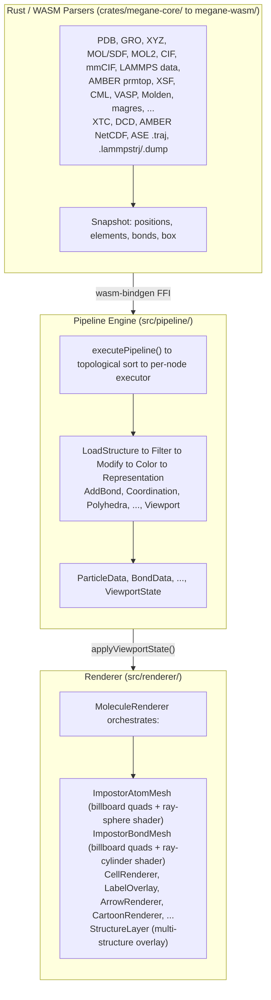

Developer guide to Megane's internal architecture: how molecular data flows from file parsing to pixels on screen, and how to extend the system.

## Design Philosophy

Megane's visual pipeline is built on three core principles:

### Typed Data Flow

The pipeline is a directed acyclic graph where edges carry one of **10 typed data channels**: `particle`, `bond`, `coordination`, `cell`, `trajectory`, `label`, `mesh`, `vector`, `volumetric`, and `spectrum`. Nodes declare typed input/output ports via `NODE_PORTS` in `src/pipeline/types.ts`. The UI prevents connections between incompatible port types at the graph level (see `canConnect()`), so executors can trust that incoming data has the expected shape.

### Separation of Computation and Rendering

Pipeline execution produces a pure data structure — `ViewportState` — with no Three.js dependencies. A separate translation layer (`applyViewportState()` in `src/pipeline/apply.ts`) maps that data to renderer method calls. This means:
- The pipeline can be tested without a WebGL context.
- The renderer can be swapped without changing pipeline logic.
- Multiple front-ends (app, widget, docs embed) share the same pipeline engine.

### GPU-Efficient Impostor Rendering

Instead of mesh-based spheres (32+ triangles each), atoms are rendered as **screen-aligned quads** (2 triangles) with ray-sphere intersection in the fragment shader. The base per-atom data costs 7 floats of GPU memory (position xyz, radius, color rgb), and the current `ImpostorAtomMesh` implementation adds 2 more floats for per-atom scale and opacity overrides (9 floats/atom total). All atoms draw in a single instanced call. This is what allows Megane to render 1M+ atoms at 60 fps on mid-range hardware.

## System Overview



## Pipeline Data Types

Ten typed channels flow through pipeline edges. Defined in `src/pipeline/types.ts`.

| Channel | Interface | Key Fields | Produced By | Consumed By |
|---------|-----------|------------|-------------|-------------|
| `particle` | `ParticleData` | `source` (Snapshot), `sourceNodeId`, `indices`, `scaleOverrides`, `opacityOverrides`, `colorOverrides`, `representationOverride`, `drawingBoundary` | LoadStructure, Streaming, Filter, Modify, Color, Representation, Symmetry, Wrap, Replicate, DrawingBoundary, BoundaryCompletion | Filter, Modify, Color, Representation, Symmetry, Wrap, Replicate, DrawingBoundary, BoundaryCompletion, AddBond, Coordination, LoadTrajectory, Labels, SurfaceMesh, Viewport |
| `bond` | `BondData` | `bondIndices`, `bondOrders`, `nBonds`, `scale`, `opacity`, `selectedBondIndices`, `bondOpacityOverrides` | AddBond, Coordination, Streaming, Filter, Modify, BoundaryCompletion | Filter, Modify, BoundaryCompletion, Viewport |
| `coordination` | `CoordinationData` | `particleRef`, `bondIndices` (center→neighbor pairs), `positions`, `elements`, `outsideBoundaryImages` | Coordination | Polyhedra |
| `cell` | `CellData` | `box` (3x3 row-major Float32Array), `sourceNodeId` | LoadStructure, Streaming, Replicate | Replicate, Viewport |
| `trajectory` | `TrajectoryData` | `provider` (FrameProvider), `meta`, `source` | LoadStructure, LoadTrajectory, Streaming, Symmetry, Wrap, Replicate | Symmetry, Wrap, Replicate, Viewport |
| `label` | `LabelData` | `labels[]`, `particleRef` | Labels | Viewport |
| `mesh` | `MeshData` | `positions`, `indices`, `normals`, `colors` (RGBA), `opacity`, `showEdges` | Polyhedra, SurfaceMesh, Isosurface | Viewport |
| `vector` | `VectorData` | `frames` (VectorFrame[]), `nAtoms`, `scale` | LoadVector, VectorOverlay | VectorOverlay, Viewport |
| `volumetric` | `VolumetricData` | `nx`, `ny`, `nz`, `origin`, `step`, `data` | LoadVolumetric | Isosurface (`volumetric` and `colorVolumetric` ports) |
| `spectrum` | `SpectrumData` | `title`, `dataType`, `xUnits`, `yUnits`, `x`, `y` | LoadSpectrum | SpectrumPlot |

Each edge in the UI is color-coded by data type (`DATA_TYPE_COLORS`). Filter and Modify nodes are generic — they accept both `particle` and `bond` inputs via `GENERIC_NODE_ACCEPTS`. The Color and Representation nodes are particle-only generic modifiers (`GENERIC_NODE_ACCEPTS` lists only `particle` for them) that share the Modify group of the "Add Node" menu (Ovito-style stack: each modifier owns one visual property — Modify = scale & opacity, Color = per-atom palette, Representation = atoms/licorice/cartoon/both/surface/line/illustrative).

Cell visibility is not a field on `CellData`: a cell is drawn whenever one reaches the viewport, and the cell axes follow the Viewport node's `cellAxesVisible` parameter. `spectrum` is the one channel that never reaches the renderer — Spectrum Plot is a terminal node that draws a 2D chart in the editor.

## Pipeline Execution

`executePipeline()` in `src/pipeline/execute.ts` drives the data flow:

1. **Topological sort** — `topologicalSort()` (Kahn's algorithm) in `src/pipeline/graph.ts` determines execution order.
2. **Per-node dispatch** — `params.type` is looked up in the `NODE_EXECUTORS` registry (`src/pipeline/executors/registry.ts`, one typed entry per node type), which calls the appropriate executor from `src/pipeline/executors/` and reports the node's warnings.
3. **Edge data propagation** — An `EdgeOutputs` map (`Map<nodeId, Map<portName, PipelineData>>`) carries outputs between nodes. `collectInputs()` gathers upstream data for each node.
4. **Disabled node passthrough** — Disabled nodes forward each input port's data to the first output port of the same data type, preserving downstream flow.
5. **ViewportState assembly** — The `viewport` executor collects the 7 renderable channels (`particle`, `bond`, `cell`, `trajectory`, `label`, `mesh`, `vector`) into a single `ViewportState`, along with the Viewport node's display settings and the representation resolved from upstream Representation nodes.
6. **Error collection** — `NodeError` objects (warning/error) accumulate per-node and are surfaced in the UI as badges.

## Rendering Layer

### MoleculeRenderer

`src/renderer/MoleculeRenderer.ts` (~1600 lines) is the main orchestrator. It owns the Three.js scene and all sub-renderers, and delegates two concerns to helper classes: `src/renderer/CameraController.ts` owns the camera (orthographic or perspective), the turntable camera controls (`src/renderer/CameraControls.ts`, OVITO-style orbit about +c / +z with no roll and no pole clamp) and the interactions on top of them (pivot animation, right-drag / Shift+left-drag pan, wheel zoom, frustum insets, projection switch), and `src/renderer/SelectionController.ts` owns screen-space picking and the selection / measurement overlays. The E2E hooks (`window.__megane_test*`) live in `src/renderer/testApi.ts`. Its API is imperative and framework-agnostic — React components call it via refs, and the widget/docs embed uses the same API.

The viewer **draws on demand**. The `requestAnimationFrame` loop keeps running (it advances the camera controls and the pivot animation), but it only redraws when the camera's pose or projection changed since the last frame, or when something called `requestRender()`; otherwise the canvas keeps the last frame and an idle viewer costs no GPU or main-thread time. Every `MoleculeRenderer` method that changes what is drawn calls `requestRender()` first (`getOrCreateLayer` / `getLayer` too, since the caller restyles the layer it gets back), and so do a resize and a restored WebGL context. Code that edits the scene or the WebGL renderer directly through `getScene()` / `getRenderer()` must call it as well; a camera moved through `getCamera()` is picked up by itself. `tests/ts/renderer/MoleculeRendererOnDemand.test.ts` lists the methods that must ask for a frame.

Scene graph structure:

```
THREE.Scene
├── Lights (hemisphere + 3-point directional)
├── ImpostorAtomMesh.mesh      (primary structure atoms)
├── ImpostorBondMesh.mesh      (primary structure bonds)
├── CellRenderer               (wireframe simulation box)
├── DrawingBoundaryAtomRenderer (periodic display copies / bond images)
├── CartoonRenderer            (cartoon representation)
├── SurfaceRenderer            (surface representation)
├── LineRenderer               (line representation, incl. per-atom "line")
├── ArrowRenderer              (per-atom vectors)
├── PolyhedronRenderer         (pipeline meshes: polyhedra, surfaces, isosurfaces)
├── Selection highlights
├── PivotMarker                (rotation center crosshair)
└── StructureLayer[]           (one per additional structure)
    ├── ImpostorAtomMesh
    ├── ImpostorBondMesh
    ├── DrawingBoundaryAtomRenderer
    └── CellRenderer
```

Two helpers sit outside the main scene: `LabelOverlay` draws Canvas 2D text on a transparent canvas stacked over the WebGL canvas, and `CellAxesRenderer` draws the a/b/c (or x/y/z) axis arrows from its own small scene into a draggable inset viewport that rotates with the main camera.

### Impostor Technique

`ImpostorAtomMesh` (`src/renderer/ImpostorAtomMesh.ts`) uses `InstancedBufferGeometry` with a single 4-vertex quad:

```
Vertex Shader                    Fragment Shader
─────────────                    ───────────────
For each instance:               For each fragment:
  Expand quad to screen-           Compute dist from center
  aligned billboard sized          If dist > 1.0 → discard
  by radius × scale                z = sqrt(1 - dist²)
                                   Write correct gl_FragDepth
                                   Apply lighting (dual diffuse
                                   + Blinn-Phong + Fresnel rim),
                                   or flat illustrative shading
```

Instance attributes per atom:
- `instanceCenter` (vec3) — world position
- `instanceRadius` (float) — vdW radius × `BALL_STICK_ATOM_SCALE` (ball-and-stick), × `SPACEFILL_ATOM_SCALE` (1.0, illustrative), or a fixed uniform radius (licorice)
- `instanceColor` (vec3) — element color from CPK/VESTA scheme
- `instanceScaleOverride` (float) — per-atom scale multiplier (default 1.0)
- `instanceOpacityOverride` (float) — per-atom opacity multiplier (default 1.0)

Global scale and opacity are O(1) uniform updates. Per-atom overrides are activated via `uUsePerAtomOverrides` uniform. The `illustrative` representation sets `uIllustrative`, which swaps the lit shading for a flat fill with a silhouette outline and a rim-darkening ramp (see [Mol\* illustrative parity](/dev/molstar-illustrative-parity)).

Instance buffers are sized to the loaded structure rather than preallocated (`src/renderer/instanceCapacity.ts`): they start at `MIN_INSTANCE_CAPACITY` (1024), grow with 25 % headroom when a structure does not fit, shrink once they are 4× larger than needed, and each upload covers only the instances actually drawn. `ImpostorBondMesh` uses the same helpers.

### Bond Rendering

`ImpostorBondMesh` (`src/renderer/ImpostorBondMesh.ts`) renders bonds as billboard quads that conservatively cover each bond's screen silhouette; the fragment shader then ray-casts the analytic cylinder in view space, so the surface and `gl_FragDepth` are correct at any viewing angle (a flat billboard parameterization is only accurate for bonds perpendicular to the camera). Atom positions are stored in a **DataTexture** and read via `texelFetch()` in the vertex shader — this means per-frame position updates cost O(nAtoms) regardless of bond count.

Bond order visualization:
- **Single** — 1 cylinder
- **Double** — 2 parallel cylinders (perpendicular offset)
- **Triple** — 3 cylinders in triangular arrangement
- **Aromatic** — 1 solid + 1 dashed offset cylinder

Bond coloring is **split by endpoint**: each bond carries two per-instance colors (`instanceColorA`/`instanceColorB`), and the fragment shader picks one based on the sign of the ray hit's axial position along the cylinder, so the half nearest each atom takes that atom's color (e.g. a C–H bond is half grey, half white). This matches the convention used by VMD/PyMOL/Mol*. The same split applies under every color scheme (by element/residue/chain/etc.) because the colors are derived from the per-atom color buffer.

Each cylinder runs from atom centre to atom centre, so its ends are buried inside the endpoint spheres. While the atoms are opaque the depth test hides that, but a transparent atom stops writing depth and the buried stick blends straight through the ball — the model then reads as beads threaded onto rods instead of one fused solid. The bond fragment shader therefore renders the **CSG union** of stick and balls: after the ray/cylinder hit is computed it discards any fragment lying inside either endpoint sphere, so the stick ends exactly on the ball's skin at any viewing angle and each pixel is covered by one surface instead of two. Because a buried point is always behind the sphere's own front face along the same ray, the trim discards precisely the fragments the depth test was already rejecting — opaque renders are pixel-identical, and transparent ones cost slightly *less* because the discarded fragments skip the lighting block.

The trim needs the radius of the ball actually on screen, which varies with the global atom scale, per-atom scale overrides and the licorice uniform radius. It rides in the otherwise-unused **alpha channel of the position DataTexture**, so the vertex shader gets it from the texel it already fetches — no extra attribute, texture or bandwidth. `ImpostorAtomMesh.setRadiusSink()` pushes the effective radii on every restyle (`MoleculeRenderer.swapRenderers` / `StructureLayer` wire it once) and `ImpostorBondMesh` mirrors them so they survive the per-frame topology rebuilds that distance-based bonding triggers. A radius of 0 — an atom hidden by a representation, or faded to fully transparent — disables the trim for that endpoint, so a stick with no ball stays whole. PBC ghost atoms, which live past the real-atom range and are drawn by a separate boundary renderer, fall back to the per-element ball-and-stick radius.

### Shader Architecture

All shaders are in `src/renderer/shaders.ts` as GLSL 3.0 ES strings, used with `RawShaderMaterial`. This requires explicit declaration of all uniforms and attributes (no Three.js auto-injection).

Lighting model (computed in the shaders, not from the scene lights):
- Hemisphere ambient (sky blue from above, warm brown from below)
- Dual directional diffuse (key + fill)
- Blinn-Phong specular highlights
- Fresnel rim lighting for depth cues
- Edge darkening for contour emphasis

### AtomRenderer / BondRenderer Interfaces

`src/types.ts` defines renderer abstraction interfaces:

```typescript
interface AtomRenderer {
  readonly mesh: THREE.Object3D;
  loadSnapshot(snapshot: Snapshot, colorCtx?: ColorContext): void;
  updatePositions(positions: Float32Array): void;
  setScale?(scale: number, snapshot: Snapshot): void;
  setUniformRadius?(radius: number | null, snapshot: Snapshot): void;
  setRadiusScale?(scale: number, snapshot: Snapshot): void;
  setIllustrative?(enabled: boolean): void;
  setOpacity?(opacity: number): void;
  setScaleOverrides?(overrides: Float32Array): void;
  setOpacityOverrides?(overrides: Float32Array): void;
  clearOverrides?(): void;
  setHiddenMask?(mask: Uint8Array | null): void;
  setRadiusSink?(sink: ((radii: Float32Array | null, scale: number) => void) | null): void;
  dispose(): void;
}
```

`BondRenderer` mirrors it (`loadSnapshot`, `updatePositions(positions, bonds, nBonds)`, `dispose`, plus optional scale/opacity, per-bond opacity overrides, `setHiddenMask`, and `setAtomRadii` / `setAtomRadiusScale` for the CSG trim). `ImpostorAtomMesh` / `ImpostorBondMesh` are the implementations `MoleculeRenderer` and `StructureLayer` use. The interfaces are the swap point for alternative renderers.

### Multi-Structure Overlay

`StructureLayer` (`src/renderer/StructureLayer.ts`) encapsulates an independent set of atom/bond/cell renderers per additional `load_structure` node. `applyViewportState()` routes the first particle source to the primary renderer and additional sources to their respective StructureLayers, keyed by `sourceNodeId`. Every viewer (MeganeViewer, the Jupyter `WidgetViewer`, `PipelineViewer`) drives it through one hook, `useViewportStateSync` (`src/hooks/useViewportStateSync.ts`), which also names the primary node whenever the snapshot the Viewport shows is not the first particle source: MeganeViewer passes the first `load_structure` node, the widget passes the node whose snapshot it shows.

## Extending Megane

### Adding a New Pipeline Node

The most common extension. The overview below lists the steps; for a complete,
copy-paste walkthrough (every touch-point, the rules, the base classes, and how
to test) see [Writing a Custom Pipeline Node](/dev/custom-nodes).

Here are the steps, using a hypothetical "ColorByProperty" node as an example:

**1. Define the node type** in `src/pipeline/types.ts`:
- Add `"color_by_property"` to the `PipelineNodeType` union
- Add a label in `NODE_TYPE_LABELS`
- Assign a category in `NODE_CATEGORY`

**2. Define parameters**:
```typescript
export interface ColorByPropertyParams {
  type: "color_by_property";
  property: "element" | "index" | "x" | "y" | "z";
  colormap: string;
}
```
Add to the `PipelineNodeParams` union and `defaultParams()` switch, and add a `case` to `summarizeNodeParams()` (`src/pipeline/nodeSummary.ts`) — the one-line summary shown on the node's card.

**3. Define ports** in `NODE_PORTS`:
```typescript
color_by_property: {
  inputs: [{ name: "particle", dataType: "particle", label: "Particle" }],
  outputs: [{ name: "particle", dataType: "particle", label: "Particle" }],
},
```

**4. Document it** with a `NODE_CATALOG` entry in `src/pipeline/catalog.ts` (description, per-param docs, prompt port text, `inPrompt`, `pythonClass`). It is compile-enforced and feeds both the LLM system prompt and the autogenerated Node Reference.

**5. Write the executor** in `src/pipeline/executors/colorByProperty.ts`:
```typescript
export function executeColorByProperty(
  params: ColorByPropertyParams,
  inputs: Map<string, PipelineData[]>,
): Map<string, PipelineData> {
  const particles = inputs.get("particle");
  if (!particles?.length) return new Map();
  const particle = particles[0] as ParticleData;
  // ... compute color overrides ...
  return new Map([["particle", { ...particle, /* modified fields */ }]]);
}
```
Follow existing patterns in `filter.ts` or `modify.ts`.

**6. Register in the execution engine** — Add a `color_by_property:` entry to `NODE_EXECUTORS` in `src/pipeline/executors/registry.ts`; `executePipeline()` (`src/pipeline/execute.ts`) dispatches through it.

**7. Create the UI node** — Add `src/components/nodes/ColorByPropertyNode.tsx` wrapping `NodeShell` (`src/components/nodes/NodeShell.tsx`), which renders the compact canvas card (`NodeCard`) or, in the properties pane, your form. Follow the pattern from `FilterNode.tsx` or `ModifyNode.tsx`.

**8. Register in the editor** — Add the component to the `nodeTypes` map in `src/components/PipelineEditor.tsx`, and the node type to the matching `ADD_NODE_GROUPS` group in `src/components/PipelineRail.tsx` so it appears in the rail's "Add Node" menu.

### Adding a New Renderer Backend

Implement the `AtomRenderer` or `BondRenderer` interface from `src/types.ts`:

- **Required**: `mesh` property, `loadSnapshot()`, `updatePositions()`, `dispose()`
- **Optional**: `setScale()`, `setUniformRadius()`, `setRadiusScale()`, `setIllustrative()`, `setOpacity()`, `setScaleOverrides()`, `setOpacityOverrides()`, `clearOverrides()`, `setHiddenMask()`, `setRadiusSink()` (atoms); `setBondOpacityOverrides()`, `setAtomRadii()`, `setAtomRadiusScale()` (bonds)

Wire it into `MoleculeRenderer` by replacing the renderer construction in `swapRenderers()` (and in `StructureLayer` for overlay structures). See `ImpostorAtomMesh` (`src/renderer/ImpostorAtomMesh.ts`) as the reference implementation.

### Adding a New Data Channel Type

If the existing 10 channels don't cover your needs:

1. Add to `PipelineDataType` union and `DATA_TYPE_COLORS` in `src/pipeline/types.ts`
2. Create the data interface (e.g., `SurfaceData`)
3. Add to the `PipelineData` union
4. Add an input port to the viewport node's `NODE_PORTS` entry (skip 4–7 for a channel that, like `spectrum`, ends at its own terminal node instead of the renderer)
5. Add a field to `ViewportState` and `DEFAULT_VIEWPORT_STATE`, and collect it in `executeViewport()` (`src/pipeline/executors/viewport.ts`)
6. Handle the new field in `applyViewportState()` (`src/pipeline/apply.ts`)
7. Implement the corresponding renderer

### Modifying Shaders

Shaders live in `src/renderer/shaders.ts` as template literal strings. Because `RawShaderMaterial` is used, you must declare all `uniform` and `in`/`out` variables explicitly.

To add a new uniform:
1. Declare it in the GLSL string (e.g., `uniform float uMyParam;`)
2. Add it to the `uniforms` object in the material constructor (in `ImpostorAtomMesh.ts` or `ImpostorBondMesh.ts`)
3. Set it from the renderer API: `this.material.uniforms.uMyParam.value = val`

### Adding a New File Format Parser

The single source of truth for cross-host format coverage is
`docs/docs/platform-support.md` — every parser change MUST update its tables in
the same PR. The full per-host registration checklist lives in the
`add-format` skill (`.agents/skills/add-format/SKILL.md`).

1. Implement the parser in Rust in `crates/megane-core/src/`
2. Add it to the format registry in `crates/megane-core/src/formats.rs`
   (`for_each_structure_format!` / `for_each_trajectory_format!`)
3. Rebuild: the WASM (`#[wasm_bindgen]`) and PyO3 (`#[pyfunction]`) `parse_*`
   functions are generated from that registry, so both hosts get the format
   under the same name
4. Add the file-extension dispatch in `src/parsers/parseCore.ts`
   (the `WasmModule` interface and `getParserForExtension`; this is the code
   the Web Worker and the sync fallback behind `parseStructureFile` in
   `src/parsers/structure.ts` both run) and the standalone accept lists
   `STRUCTURE_EXTS` / `TRAJECTORY_EXTS` in `src/parsers/fileNames.ts`
   (read by `LoadStructureNode.tsx` / `LoadTrajectoryNode.tsx`)
5. Register the type on every host: `jupyterlab-megane/src/filetypes.ts`
   (JupyterLab `IFileType`) and `vscode-megane/package.json`
   (VS Code `customEditors`)
6. Wire the Python `LoadStructure` / `LoadTrajectory` dispatch in
   `python/megane/pipeline.py` (`_load_structure_file` / `_load_trajectory_data`)
7. Update `docs/docs/platform-support.md`, `docs/docs/introduction.md`,
   `docs/docs/getting-started.md`, and `README.md`

## Key File Index

| Subsystem | Files |
|-----------|-------|
| **Core types** | `src/types.ts` (Snapshot, Frame, AtomRenderer, BondRenderer) |
| **Pipeline types** | `src/pipeline/types.ts` (data channels, ports, node params, ViewportState) |
| **Pipeline engine** | `src/pipeline/execute.ts`, `src/pipeline/graph.ts` |
| **Node docs** | `src/pipeline/catalog.ts` (`NODE_CATALOG`: LLM prompt + Node Reference) |
| **Serialization** | `src/pipeline/serialize.ts` (`SerializedPipeline` v3), `src/pipeline/builder.ts` / `python/megane/pipeline.py` (programmatic builders) |
| **Pipeline → Renderer** | `src/pipeline/apply.ts` |
| **Node executors** | `src/pipeline/executors/` (one file per node type, plus parsing/geometry helpers) |
| **Node UI** | `src/components/nodes/`, `src/components/PipelineEditor.tsx`, `src/components/PipelineRail.tsx`, `src/components/graph/` (graph kit shared with the Builder's Flow mode: `GraphCanvas`, `GraphEditorPanel`, `GraphProperties`, `NodeCardView`, `PanelRail`) |
| **Selection DSL** | `src/pipeline/selection.ts` (recursive-descent parser/evaluator) |
| **Main renderer** | `src/renderer/MoleculeRenderer.ts` |
| **Atom impostor** | `src/renderer/ImpostorAtomMesh.ts` |
| **Bond impostor** | `src/renderer/ImpostorBondMesh.ts` |
| **Shaders** | `src/renderer/shaders.ts` |
| **Multi-structure** | `src/renderer/StructureLayer.ts` |
| **Camera/controls** | `src/renderer/CameraController.ts` (camera state, pan / zoom / pivot interactions), `src/renderer/CameraControls.ts` (turntable orbit), `src/renderer/CameraManager.ts` (fit, insets, zoom helpers), `src/renderer/cameraOrientation.ts` (VESTA standard orientation, ±a/±b/±c and ±x/±y/±z views) |
| **Picking / selection** | `src/renderer/Picking.ts` (screen-space helpers), `src/renderer/SelectionController.ts` (picking against the live view, selection overlays) |
| **Element data** | `src/constants.ts` (colors, vdW radii, bond params) |
| **Color schemes** | `src/colorSchemes.ts` (by element/residue/chain/B-factor/property, illustrative) |
| **File parsing (TS side)** | `src/parsers/` (`structure.ts` facade, `parseCore.ts` WASM dispatch, `parse.worker.ts`, `fileNames.ts`) |
| **WASM parsers** | `crates/megane-core/`, `crates/megane-wasm/` |
| **Python bindings** | `crates/megane-python/`, `python/megane/` |
| **Pipeline store** | `src/pipeline/store.ts` (Zustand) |
| **Binary protocol** | `src/protocol/protocol.ts` (decoder; mirrors the encoder in `python/megane/protocol.py`), `src/protocol/WorkerPool.ts` + `decode.worker.ts` (off-main-thread decoding) |
| **Frame providers** | `src/stream/WebSocketClient.ts` (reconnecting client for the `megane serve` backend in `python/megane/server.py`), `src/stream/StreamFrameProvider.ts` (WebSocket `request_frame` + LRU cache), `src/stream/LazyFrameProvider.ts` (parse-worker-backed lazy frame decoding); both caches are capped in frames and in bytes (`src/stream/frameCacheCapacity.ts`, 32 MiB by default); the lazy decoders (XTC, DCD, NetCDF, LAMMPS dump, multi-frame XYZ / PDB, ASE `.traj`) index the `File` from windows of it and read each frame's bytes when it is decoded, instead of holding the file in the worker (`indexXtcFileCore`, `indexBinaryTrajectoryFileCore`, `indexDumpFileCore`, `indexStructureFileCore`, `indexTrajFileCore` in `src/parsers/parseCore.ts`) |
